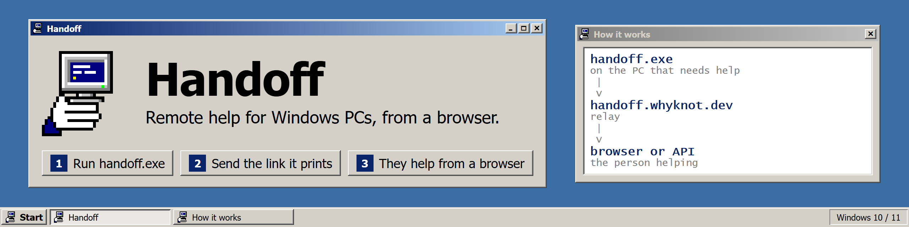

<p align="center">
  
</p>

<p align="center">
  <a href="https://github.com/RealWhyKnot/Handoff/actions/workflows/ci.yml"></a>
  <a href="https://github.com/RealWhyKnot/Handoff/releases/latest"></a>
  <a href="https://handoff.whyknot.dev"></a>
  
  <a href="LICENSE"></a>
</p>

<p align="center">
  <a href="https://github.com/RealWhyKnot/Handoff/releases/latest">Download</a> ·
  <a href="https://handoff.whyknot.dev">Website</a> ·
  <a href="https://handoff.whyknot.dev/docs">API docs</a> ·
  <a href="https://github.com/RealWhyKnot/Handoff/issues/new?template=bug_report.yml">Report a bug</a> ·
  <a href=".github/SECURITY.md">Security</a>
</p>

Handoff lets someone help with your Windows PC from their browser. You run `handoff.exe` and send the link it prints to the person helping you. They pick commands on the session page, the commands run on your PC, and the results show up on their screen. Your Handoff console lists every command they run and whether it worked.

Your PC only makes an outgoing connection to the relay at handoff.whyknot.dev, so there are no ports to open and no VPN to set up. The link is the only thing you share.

## What the helper can do

There are 57 commands. They cover system and hardware info, network checks (ping, traceroute, DNS, HTTP, TLS, Wi-Fi, firewall), processes and services, event logs and drivers, the registry, Windows Update and Defender status, installed apps, files, Raspberry Pi Pico boards and PowerShell. A helper can also open a tunnel to a port on your PC or to a device on your network, such as a router's admin page. The [command reference](https://handoff.whyknot.dev/docs#commands) lists each one with its options.

## What needs your OK

Anything that would change your PC waits for you to say yes: killing a process, controlling a service, creating, uploading or deleting files, running PowerShell, opening a tunnel, and putting a Pico into BOOTSEL mode or flashing, saving or resetting it. A yes allows that command for the rest of the session. A no blocks it until the session ends.

If you only want them to look, start with `handoff new --consent deny`. That session turns down every request that would change the PC.

Press Ctrl+C or `q` in the Handoff console to end the session.

## Install

1. Download `handoff.exe` from the [latest release](https://github.com/RealWhyKnot/Handoff/releases/latest).
2. Run it. With no arguments it shows a menu, and `handoff new` starts a session straight away.
3. Send the link it prints to the person helping you.

Needs 64-bit Windows 10 or 11.

To update, run `handoff update`. It downloads the new release next to the running exe and checks it against the SHA-256 published with the release. `handoff update --check` only tells you whether there is one.

To uninstall, delete `handoff.exe`. To remove everything it wrote, also delete `%APPDATA%\whyknot\handoff\` (config), `%LOCALAPPDATA%\whyknot\handoff\` (logs) and `%PROGRAMDATA%\whyknot\handoff\` (audit trail).

## For helpers and scripts

Open the link in any browser. From a terminal, `handoff connect <link>` opens it for you and `handoff exec <token> <kind>` runs one command and prints the result.

The relay has a public HTTP API, so a script can do the same thing:

```sh
curl -sS -X POST 'https://handoff.whyknot.dev/api/sessions/<view-token>/run' \
  -H 'Content-Type: application/json' \
  -d '{"kind":"sys.uptime"}'
```

The [API docs](https://handoff.whyknot.dev/docs) cover every endpoint, and the OpenAPI description is at [/openapi.json](https://handoff.whyknot.dev/openapi.json).

## How it works

```
handoff.exe            on the PC that needs help
   v  WebSocket, outbound only
handoff.whyknot.dev    relay
   v  HTTPS and WebSocket
browser or script      the person helping
```

`handoff new` creates a one-time session on the relay and keeps a WebSocket open to it. Commands from the helper go to the relay, then down that socket to your PC, and each result comes back the same way. The session ends when you close Handoff.

## Building from source

```powershell
git clone https://github.com/RealWhyKnot/Handoff
cd Handoff
cargo build --release
```

The exe ends up at `target/release/handoff.exe`. `rust-toolchain.toml` pins the Rust version. The `pico.*` commands use the `picotool` on the host's PATH. To build it into the exe instead:

```powershell
./scripts/fetch-picotool.ps1
cargo build --release --features embed_picotool
```

[CONTRIBUTING.md](CONTRIBUTING.md) covers the checks a pull request has to pass.

## License

GPL-3.0-or-later. See [LICENSE](LICENSE).
